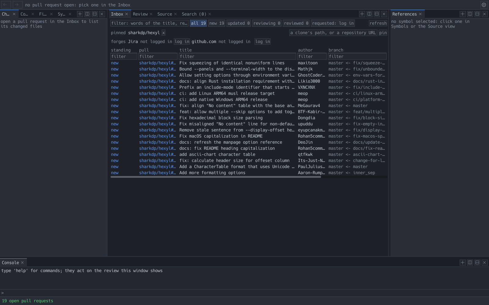
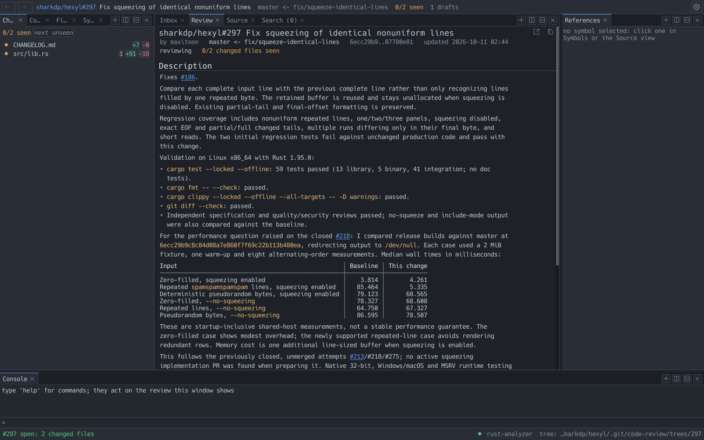
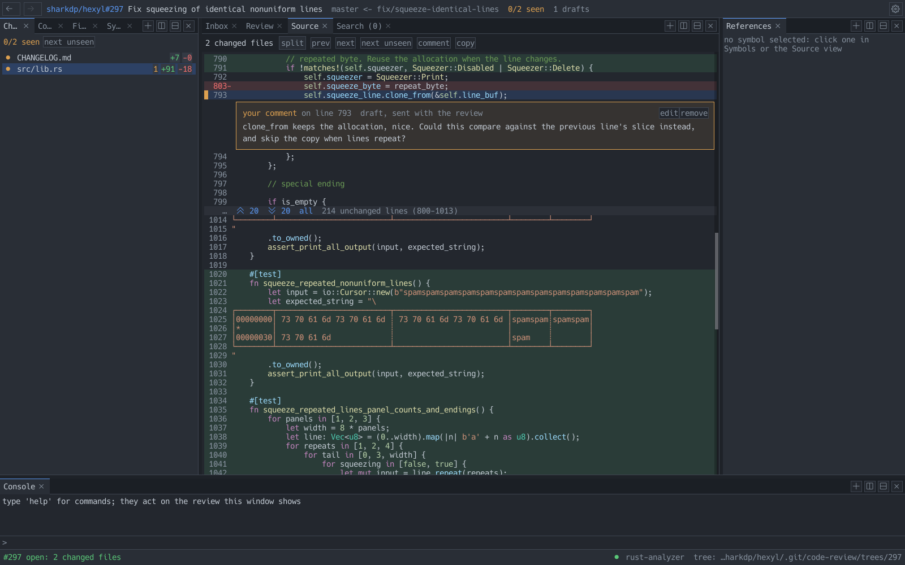
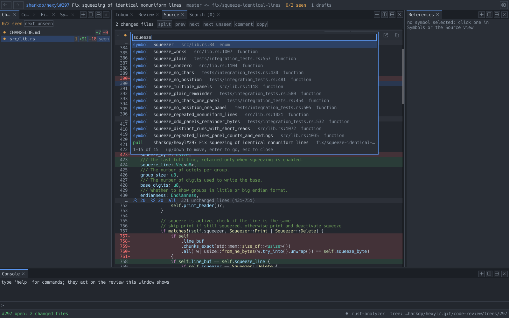

# code-review

A small native app for reviewing pull requests with features you'd expect from your IDE.


The Inbox lists every open pull request across the repositories you've added, with the
ability to sort and filter.


The PR overview is as you'd expect from GitHub, but also has optional Jira integration
to view the ticket associated with the PR (so long as the ticket number is in the title
or description).


The Source view contains all the changes for each file together with typical LSP actions,
such as Go to Definition & References.


The command palette can be used to navigate to files, symbols, or pull requests.


## Using it

```
cargo build --release
target/release/review              # the window
target/release/review help         # the same commands in the terminal
```

It needs `git` and `curl` on your PATH. LSP integration covers Rust, C, Python,
JavaScript and TypeScript, and Odin. When one isn't installed, a built-in tree-sitter
resolver is used.
